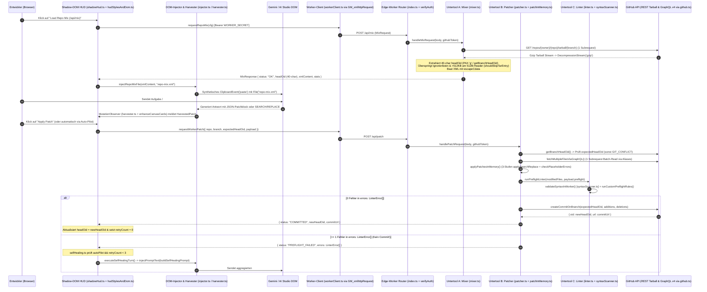

# Projekt-Review & Vollständige Dokumentation des Zusammenspiels (`01_PROJECT_REVIEW_AND_HANDOFF.md`)

> **Verwendungszweck:** Autoritative Gesamtdokumentation des Zusammenspiels aller 3 Schichten und 18 TypeScript-Module sowie strukturierte Checkliste für das vorab geplante Code- & Security-Review (`#review`).

---

## 1. Vollständiges Zusammenspiel aller Einzelteile & Subroutinen (End-to-End Architektur)

### A. Sequenzdiagramm des Gesamtsystems (Mix -> Paste -> Harvest -> Patch -> Lint -> Self-Heal / Commit)

---

### B. Modul- & Subroutinen-Verzeichnis (Alle 18 TypeScript-Dateien `< 500` Zeilen)

| Schicht | Datei & Zeilen | Exporte & Verantwortlichkeit im Zusammenspiel | Aufgerufene Subroutinen / Abhängigkeiten |
| :--- | :--- | :--- | :--- |
| **Shared** | [shared/types.ts](file:///y:/projekte2026/website/gitTrans/githubgeminibridge/shared/types.ts) (`119 Z.`) | Kanonische V2-Verträge (`WorkerEnv`, `MixRequest`, `MixResponse`, `GeminiPatchPayload`, `WorkerPatchRequest`, `WorkerPatchResponse`, `LinterError`) & V1-Verträge (`CommitRequest`, `FileChangeInput`). | Keine (Wurzel-Vertrag für Worker & HUD) |
| **Worker** | [packages/edge-worker/src/types.ts](file:///y:/projekte2026/website/gitTrans/githubgeminibridge/packages/edge-worker/src/types.ts) (`2 Z.`) | Re-Exportiert alle Typen aus `../../../shared/types`. | `shared/types.ts` |
| **Worker** | [packages/edge-worker/src/index.ts](file:///y:/projekte2026/website/gitTrans/githubgeminibridge/packages/edge-worker/src/index.ts) (`220 Z.`) | Edge-Entrypoint (`fetch`), CORS-Handling, `verifyAuth`, `resolveSecret`, `resolveGithubToken`, Routing für `GET /health`, `POST /api/mix`, `POST /api/patch`, V1 `POST /push`, `/commit`, `/graphql`. | `mixer.ts`, `patcher.ts`, `github.ts`, `encoding.ts` |
| **Worker** | [packages/edge-worker/src/utils/encoding.ts](file:///y:/projekte2026/website/gitTrans/githubgeminibridge/packages/edge-worker/src/utils/encoding.ts) (`28 Z.`) | `utf8ToBase64`, `base64ToUtf8` für GitHub GraphQL `CreateCommitOnBranchInput`. | Web-Standard `TextEncoder` / `TextDecoder` |
| **Worker** | [packages/edge-worker/src/utils/github.ts](file:///y:/projekte2026/website/gitTrans/githubgeminibridge/packages/edge-worker/src/utils/github.ts) (`432 Z.`) | `parseRepoOwner`, `executeGraphQL`, `getBranchHeadOid`, `fetchFileContent`, `fetchMultipleFilesViaGraphQL` (1-Subrequest Batch-Read), `createCommitOnBranch`, `commitSingleFileViaGraphQL`. | `encoding.ts` |
| **Worker** | [packages/edge-worker/src/modules/mixer.ts](file:///y:/projekte2026/website/gitTrans/githubgeminibridge/packages/edge-worker/src/modules/mixer.ts) (`487 Z.`) | Untertool A: `handleMixRequest`, `parseTarStream`, `shouldSkipTarEntry` (Header-Level RAM-Filter), `extractHeadOidFromPaxHeader`, `escapeCdata`. | `github.ts` (`getBranchHeadOid`, `commitSingleFileViaGraphQL`) |
| **Worker** | [packages/edge-worker/src/modules/patcher.ts](file:///y:/projekte2026/website/gitTrans/githubgeminibridge/packages/edge-worker/src/modules/patcher.ts) (`366 Z.`) | Untertool B: `handlePatchRequest`, `applySearchReplace` (3-Stufen-Match), `validateNoPlaceholders`, `parseSearchReplaceBlocks`, V1 `resolveFileContent` + Re-Exports aus `patchInMemory.ts`. | `patchInMemory.ts`, `linter.ts`, `github.ts`, `encoding.ts` |
| **Worker** | [packages/edge-worker/src/modules/patchInMemory.ts](file:///y:/projekte2026/website/gitTrans/githubgeminibridge/packages/edge-worker/src/modules/patchInMemory.ts) (`290 Z.`) | Subroutine zu `patcher.ts`: `applyPatchesInMemory` (Non-Fail-Fast Fehler-Sammlung & Idempotenz-Check `hasEffectiveChanges`), `runBuiltinPreflightRules`, `checkPlaceholderErrors`, `PreflightLinterHook`. | `patcher.ts` (`applySearchReplace`), `linter.ts` (`runPreflightLinter`) |
| **Worker** | [packages/edge-worker/src/modules/linter.ts](file:///y:/projekte2026/website/gitTrans/githubgeminibridge/packages/edge-worker/src/modules/linter.ts) (`90 Z.`) | Untertool C: `runPreflightLinter` (kompatibel zu `PreflightLinterHook`), `runCustomPreflightRules`, Fehler-Deduplizierung + Re-Exports aus `syntaxScanner.ts`. | `syntaxScanner.ts`, `patchInMemory.ts` |
| **Worker** | [packages/edge-worker/src/modules/syntaxScanner.ts](file:///y:/projekte2026/website/gitTrans/githubgeminibridge/packages/edge-worker/src/modules/syntaxScanner.ts) (`335 Z.`) | Subroutine zu `linter.ts`: `validateSyntaxInWorker` (AST-/Lexikal-Scanner für `.ts`/`.tsx`/`.js`/`.jsx`/`.json`, Klammer-Stack, Template-Nesting, Conflict-Marker) & `registerOxcWasmParser`. | `types.ts` (`LinterError`) |
| **HUD** | [packages/userscript-hud/src/types.ts](file:///y:/projekte2026/website/gitTrans/githubgeminibridge/packages/userscript-hud/src/types.ts) (`95 Z.`) | Re-Export aus `shared/types.ts` + `HudConfig`, `HudState`, `HarvestedPatch`, Ambient `GM_*` & `trustedTypes`. | `shared/types.ts` |
| **HUD** | [packages/userscript-hud/src/services/storage.ts](file:///y:/projekte2026/website/gitTrans/githubgeminibridge/packages/userscript-hud/src/services/storage.ts) (`132 Z.`) | `sanitizeNoGithubPat` (blockiert `ghp_*` / `github_pat_*` im Browser), `getStoredValue`, `setStoredValue`, `loadHudConfig`, `saveHudConfig`. | `GM_getValue` / `GM_setValue` / `localStorage` |
| **HUD** | [packages/userscript-hud/src/services/workerClient.ts](file:///y:/projekte2026/website/gitTrans/githubgeminibridge/packages/userscript-hud/src/services/workerClient.ts) (`151 Z.`) | CSP-Bypass über `GM_xmlhttpRequest`: `gmRequestJson`, `checkWorkerHealth`, `requestRepoMix`, `requestWorkerPatch`, `requestLegacyCommit`. | `types.ts` |
| **HUD** | [packages/userscript-hud/src/services/selfHealing.ts](file:///y:/projekte2026/website/gitTrans/githubgeminibridge/packages/userscript-hud/src/services/selfHealing.ts) (`156 Z.`) | Self-Healing Engine: `MAX_SELF_HEALING_RETRIES = 3`, `buildSelfHealingPrompt`, `shouldTriggerSelfHealing`, `executeSelfHealingTurn`. | `injector.ts` (`injectPromptText`) |
| **HUD** | [packages/userscript-hud/src/dom/injector.ts](file:///y:/projekte2026/website/gitTrans/githubgeminibridge/packages/userscript-hud/src/dom/injector.ts) (`129 Z.`) | `findPromptInputElement` (Gemini & AI Studio), `injectRepoMixFile` (`File` + `DataTransfer` + `ClipboardEvent('paste')`), `injectPromptText`. | Browser DOM |
| **HUD** | [packages/userscript-hud/src/dom/harvester.ts](file:///y:/projekte2026/website/gitTrans/githubgeminibridge/packages/userscript-hud/src/dom/harvester.ts) (`370 Z.`) | `startDomHarvester` (`MutationObserver`), `parseV2PatchPayloadFromCode`, `convertLegacyBlocksToV2Payload`, `enhanceCanvasCards` (Gemini Canvas). | `hudStylesAndDom.ts` (Trusted-Types DOM) |
| **HUD** | [packages/userscript-hud/src/ui/shadowHud.ts](file:///y:/projekte2026/website/gitTrans/githubgeminibridge/packages/userscript-hud/src/ui/shadowHud.ts) (`382 Z.`) | `mountShadowHud` Controller: verwaltet `HudState` (`headOid`, `retryCount`, `harvestedPatches`), steuert Mix-, Patch- und Self-Healing-Workflows. | `hudStylesAndDom.ts`, `storage.ts`, `workerClient.ts`, `injector.ts`, `selfHealing.ts` |
| **HUD** | [packages/userscript-hud/src/ui/hudStylesAndDom.ts](file:///y:/projekte2026/website/gitTrans/githubgeminibridge/packages/userscript-hud/src/ui/hudStylesAndDom.ts) (`406 Z.`) | Subroutine zu `shadowHud.ts`: `HUD_SHADOW_STYLES`, Trusted-Types-sichere DOM-Fabrik (`buildHudDomTree`, `createHudElement`, `setSafeText`). | Keine `innerHTML`-Zuweisungen |
| **HUD** | [packages/userscript-hud/src/index.ts](file:///y:/projekte2026/website/gitTrans/githubgeminibridge/packages/userscript-hud/src/index.ts) (`60 Z.`) | Bootstrap-Entrypoint (`initGeminiEdgeHud`), verbindet `mountShadowHud` und `startDomHarvester`; gebündelt via `scripts/build-userscript.mjs` nach Root [gemini-bridge.user.js](file:///y:/projekte2026/website/gitTrans/githubgeminibridge/gemini-bridge.user.js). | Alle HUD-Module |

---

## 2. Checkliste für das 3-Punkte-Projekt-Review (`#review`)

Wenn du im neuen Chat **Prompt B** aus [plans/00_STARTCHAT_ORCHESTRATOR.md](file:///y:/projekte2026/website/gitTrans/githubgeminibridge/plans/00_STARTCHAT_ORCHESTRATOR.md) ausführst, werden folgende Punkte systematisch geprüft:

1. **Prüfpaket 1 – Edge-Worker & Subroutinen (`packages/edge-worker/src/`):**
   - [ ] Werden `WORKER_SECRET`/`BRIDGE_SECRET` und `GITHUB_PAT`/`GITHUB_TOKEN` in keinem Erfolgs- oder Fehler-Log ausgegeben?
   - [ ] Behandelt `mixer.ts` 512-Byte TAR-Blöcke über beliebige Stream-Chunk-Grenzen von `DecompressionStream('gzip')` hinweg verlustfrei?
   - [ ] Ist sichergestellt, dass `headOid` bei `persistToGitHub === true` auf `persistedCommitOid` aktualisiert wird?
   - [ ] Sammeln `patchInMemory.ts`, `linter.ts` und `syntaxScanner.ts` wirklich alle Fehler über alle Dateien ohne Fail-Fast und ohne Duplikate?
2. **Prüfpaket 2 – Userscript Shadow-DOM HUD & Subroutinen (`packages/userscript-hud/src/`):**
   - [ ] Ist im gesamten gebauten [gemini-bridge.user.js](file:///y:/projekte2026/website/gitTrans/githubgeminibridge/gemini-bridge.user.js) sichergestellt, dass keine ungeschützte `innerHTML`-Zuweisung einen Trusted-Types-Fehler auf `gemini.google.com` oder `aistudio.google.com` auslöst?
   - [ ] Verhindert `sanitizeNoGithubPat` in `storage.ts` zuverlässig jede Speicherung eines GitHub-Tokens im Browser?
   - [ ] Stoppt `selfHealing.ts` garantiert bei `retryCount >= 3` (`MAX_SELF_HEALING_RETRIES`)?
3. **Prüfpaket 3 – Übergabe an den Live-Deployment-Plan:**
   - [ ] Nach `PASS` aller Review-Kriterien direkte Freigabe für [plans/02_LIVE_DEPLOYMENT_AND_E2E_PLAN.md](file:///y:/projekte2026/website/gitTrans/githubgeminibridge/plans/02_LIVE_DEPLOYMENT_AND_E2E_PLAN.md).
