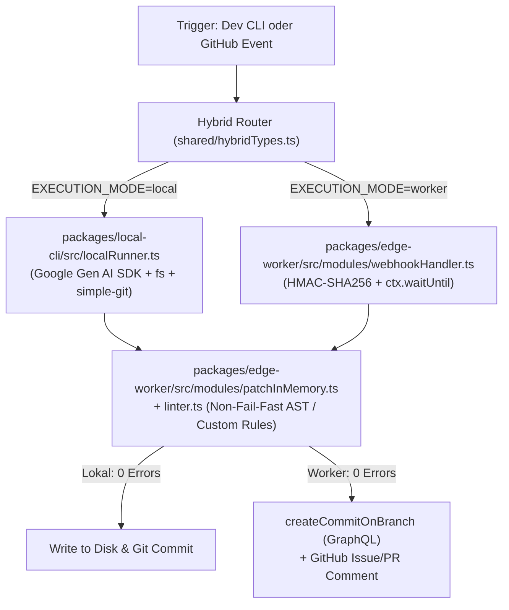

# HYBRID ROUTING BLUEPRINT: STAGE 5 (`cloudflare_orchestrator_Bridge`)

## Mandatory Execution Metadata Header
- **Stage:** 5 (Hybrid Routing: Local CLI vs. Cloudflare Worker GitHub Webhook)
- **Target Components:**
  - `shared/hybridTypes.ts` (Schnittstellen-Verträge für hybride Workflows)
  - `packages/local-cli/` (Pfad A: Node.js CLI mit `@google/genai`, `simple-git`, `fs` & In-Memory Preflight)
  - `packages/edge-worker/src/modules/webhookHandler.ts` & `src/index.ts` (Pfad B: Webhook-Route `POST /api/webhook/github` mit HMAC-SHA256 & `ctx.waitUntil`)
- **Overall Complexity:** 5/10 (Klare Trennung durch Disjunkte Module, nutzt bestehende `patchInMemory.ts` & `linter.ts`)
- **Delegation Target:** Artifact Executor Subagent
- **P1 Invariant Compliance:**
  1. Zero Node.js imports (`fs`, `child_process`, `simple-git`) in `packages/edge-worker/`.
  2. Pure Web Crypto (`HMAC-SHA256`) für GitHub Webhook Signatur-Prüfung (`x-hub-signature-256`).
  3. GitHub Webhook 10s-Timeout Schutz: Sofort `202 Accepted`, Gemini & GraphQL-Commit im Hintergrund via `ctx.waitUntil`.
  4. P1 Preflight Hard Guardrail: Jeder Pfad (Lokal & Worker) validiert Änderungen über `applyPatchesInMemory` + `runPreflightLinter` vor dem Festplatten-/Git-Write.
  5. File-Size Modularity: Alle neuen Dateien strikt `< 500` Zeilen.

---

## 1. Context & Data Flow

---

## 2. Implementation Steps

### Step 1: Verträge & Typen (`shared/hybridTypes.ts`)
- Definiere `ExecutionMode = 'local' | 'worker'`, `HybridTaskInput`, `HybridTaskResult` und `HybridWorkerEnv`.
- Re-exportiere diese in `shared/types.ts`.

### Step 2: Pfad A – Lokales CLI-Paket (`packages/local-cli/`)
- Erstelle `packages/local-cli/package.json` und `tsconfig.json`.
- Implementiere `packages/local-cli/src/localRunner.ts`:
  - Liest `.env` (`GEMINI_API_KEY`, optional `GITHUB_PAT`).
  - Sammelt lokalen Datei-Kontext der angegebenen Pfade.
  - Fragt Gemini API via `@google/genai` nach `GeminiPatchPayload` JSON.
  - Wendet `applyPatchesInMemory` und `runPreflightLinter` an.
  - Erst bei 0 Fehlern: Schreibt auf Disk und committet lokal via `simple-git`.
- Erstelle CLI-Entrypoint `packages/local-cli/src/cli.ts` (ausführbar mit `node`).

### Step 3: Pfad B – Edge-Worker GitHub Webhook (`packages/edge-worker/`)
- Erstelle `packages/edge-worker/src/modules/webhookHandler.ts`:
  - `verifyGithubWebhookSignature(rawBody, signatureHeader, secret)` per Web Crypto `crypto.subtle.verify`.
  - Filtert auf `@gemini`-Erwähnungen in Issues / PR-Kommentaren.
  - Führt asynchron via `ctx.waitUntil`: Repo-Mix (`handleMixRequest`) -> Gemini REST Call -> Patcher (`handlePatchRequest`) -> GitHub Kommentar-Feedback aus.
- Verdrahte Route `POST /api/webhook/github` in `packages/edge-worker/src/index.ts` **vor** der Standard-`verifyAuth` (da Webhooks über HMAC signiert sind).

### Step 4: Smoke-Test-Erweiterung & Verifikation
- Erweitere `scripts/patches_and_tests/worker-smoke.mjs` um Probe 11:
  - Prüft HMAC-Signatur-Validierung im Webhook-Handler.
  - Prüft, dass `packages/edge-worker/` keine Node-Builtins importiert.
- Führe TypeScript-Checks (`tsc --noEmit`) und Smoke-Suite (`worker-smoke.mjs`) aus.
- Protokolliere den Fortschritt in `plans/EXECUTION_LOG.md`, `plans/TEST_LOG.md` und `plans/STATE.md`.
